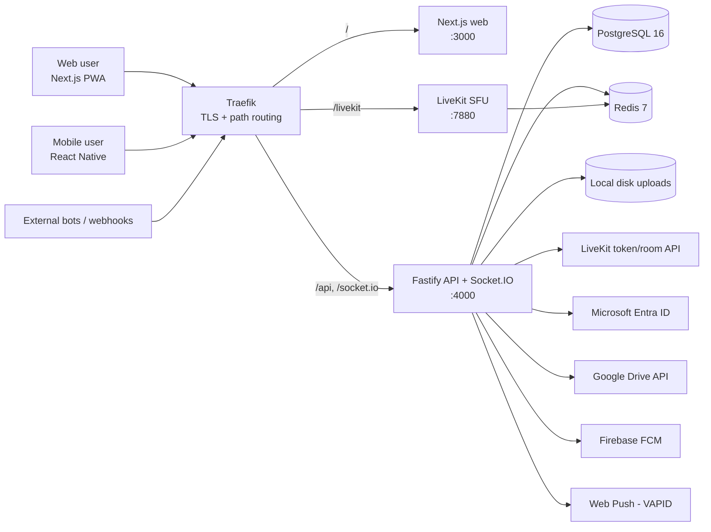
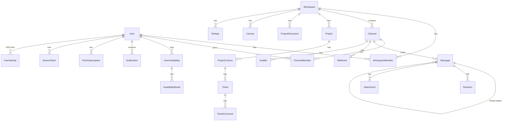
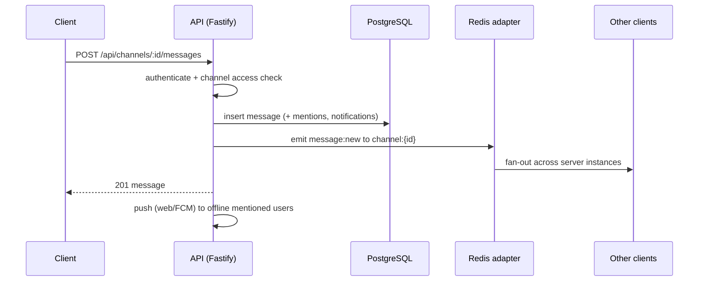
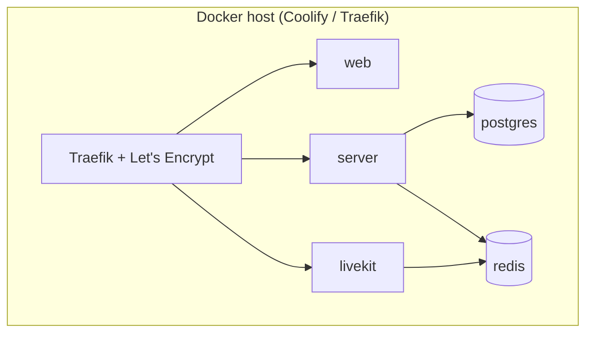

# Orbit: High-Level Design

Orbit is a self-hostable, Slack-style team collaboration platform. It combines chat with project management, docs, whiteboards, availability tracking and voice/video huddles. It ships as a web app and a React Native mobile app.

## 1. Goals and scope

**Functional**
- Multi-tenant workspaces with roles (Owner, Admin, Member, Guest) and admin-added membership
- Public, private and anonymous channels, DMs and group DMs
- Threads, quoted replies, reactions/emojis, pins, mentions, search and file attachments
- Huddles: audio, video and screen share
- Bots, incoming webhooks and slash commands
- Projects (Kanban tickets), Notion-style docs, whiteboard canvases
- Employee availability and time tracking
- Project media via Google Drive
- Web push and mobile (FCM) notifications
- Super-admin console

**Non-functional**
- Real-time delivery with low latency
- Horizontal scalability of the realtime layer (Redis adapter)
- Self-hosting through Docker
- Per-request authorization and account deactivation

## 2. System context

## 3. Architecture

A monorepo using npm workspaces.

| Layer | Tech | Location |
|---|---|---|
| Web client | Next.js 14 (App Router), React 18, Tailwind, Radix UI, Zustand, React Query | `apps/web` |
| Mobile client | React Native 0.88, NativeWind, React Navigation (separate from workspaces) | `apps/mobile` |
| API server | Node 22, Fastify 4, zod validation | `apps/server` |
| Realtime | Socket.IO 4 with Redis adapter | `apps/server/src/socket` |
| Database | PostgreSQL 16 via Prisma 5 | `packages/db` |
| Shared types | TS models and `SOCKET_EVENTS` constants | `packages/types` |
| Media (calls) | LiveKit SFU, self-hosted | `docker/livekit.yaml` |

**Server structure**
- `routes/`: REST modules (auth, workspaces, channels, messages, files, huddles, bots, admin, projects, documents, canvases, availability, drive, push, avatar)
- `services/`: domain and integration logic (storage, livekit, pushService, mentionService, microsoftAuth, driveAuth, anonymousService, systemBot, demoWorkspace)
- `utils/security.ts`: central workspace/channel/canvas access checks
- `socket/index.ts`: handshake auth, room management, presence, typing, whiteboard relay

**Client structure**
- Zustand stores for UI/session state
- React Query and axios for REST
- A singleton socket client that feeds the stores
- A service worker (`sw.js`) for web push
- Client-side compression (`fflate`) before upload

## 4. Core components and responsibilities

| Component | Responsibility |
|---|---|
| Auth | Local email/password (bcrypt), optional Microsoft Entra OIDC, JWT (HS256) issuance |
| Workspace | Tenancy, membership and roles, theme and settings |
| Channel/DM | Channel types, membership, unread counts, anonymous personas |
| Messaging | Messages, threads, quotes, reactions, pins, search, mentions, attachments |
| Realtime | Fan-out of events to `user:`, `workspace:`, `channel:` and canvas rooms; presence; typing |
| Huddles | Server issues LiveKit tokens and controls participants; clients connect to the SFU directly |
| Bots | Bot tokens, `chat.postMessage`, webhooks, slash commands, system bot |
| Projects | Projects, columns, tickets, comments, watchers, live board updates |
| Docs/Canvas | Documents with per-user and public share links; whiteboard data and cursor relay |
| Availability | Check-in, breaks and checkout, team view; 15-minute auto-checkout job |
| Media | Google Drive folders and files per project, resumable uploads |
| Notifications | In-app (socket), web push (VAPID), mobile push (FCM) |
| Admin | Stats, user management, workspace management, demo workspace generator |

## 5. Data architecture

Core entities and relationships (PostgreSQL, uuid keys):

**Design notes**
- Workspace deletion cascades to most children.
- `Message.user` and `Attachment.uploader` use SetNull to preserve history.
- Reactions are unique on (message, user, emoji). Memberships are unique on their pairs.
- Indexes: (channelId, createdAt) on messages, and (userId, read) on notifications.
- Soft delete flags (`isDeleted`) apply to messages and attachments.
- Google Drive tokens are held in a singleton `GoogleOAuth` row.

## 6. Key flows

**Authentication**
1. The client calls `POST /api/auth/login` (or the Microsoft redirect and callback) and receives a 15-minute access JWT plus a rotating refresh token.
2. REST requests send `Authorization: Bearer`. Sockets send the token in the handshake, and only a valid JWT is accepted.
3. On every request `fastify.authenticate` verifies the JWT and checks `User.disabled`.
4. On a 401 the client calls `POST /api/auth/refresh`, gets a new pair (the old refresh token is retired) and replays the request. `POST /api/auth/logout` revokes the session.

**Sending a message**

**Huddle**
1. The client calls `POST /api/huddles/:channelId/token` and the server returns a LiveKit token.
2. The client connects to LiveKit (`/livekit`) directly for media.
3. The server broadcasts `huddle:started`/`joined`/`left` and sets presence to IN_HUDDLE.

**File upload**
1. The client compresses the file and sends multipart `POST /api/files/upload` (50 MB limit).
2. `StorageDriver` writes to `UPLOAD_DIR/workspaces/:id/:yyyy-mm/:key`.
3. An `Attachment` row is created.

## 7. API and realtime surface

- REST under `/api/*`, grouped by module as in §3. Health check at `GET /api/health`.
- Public endpoints: avatar, push public key, webhook ingest, doc share links, Drive file content.
- Socket.IO events are typed in `SOCKET_EVENTS`:
  - Client to server: join/leave rooms, typing, huddle state, whiteboard updates.
  - Server to client: `message:*`, `channel:*`, `huddle:*`, `project/ticket/column/document:*`, `notification:new`, `availability:update`, `user:status_change`, `workspace:kicked`, `account:deactivated`.

## 8. Deployment

- Local dev: `docker-compose.yml` runs Postgres, Redis and LiveKit. The apps run via `npm run dev` (web on 3000, API on 4000).
- Production: `docker-compose.prod.yml` runs 5 services behind Traefik. Postgres and Redis are not published.
- The server container runs `prisma db push` on boot, then starts the API.
- LiveKit needs 7880/7881 and UDP 40000-40050.
- An alternative manual deploy using PM2 is documented in `deploy.txt`.

## 9. Scalability and availability

- The API is stateless apart from an in-memory `userSocketMap` and the uploads directory. The Redis adapter lets Socket.IO scale across instances.
- LiveKit scales independently as an SFU.
- Postgres is a single instance (scale vertically, add read replicas later).
- The 15-minute auto-checkout runs in-process with no leader election. It would run on every instance once the server is horizontally scaled.

## 10. Security model

- Sessions: short-lived access tokens and rotating, hashed, server-side refresh tokens. A rotated token replayed after a 15-second grace window revokes its whole session family.
- Authorization is layered: JWT, then `SystemRole` (SUPER_ADMIN gates `/api/admin`), then `WorkspaceRole`, then channel/canvas membership via `utils/security.ts`.
- Passwords are hashed with bcrypt. A super admin can reset passwords, and a user can change their own.
- Input is validated with zod. Disabled accounts are rejected on REST and on socket connect.
- Public share links use unguessable tokens.

## 11. Known gaps and risks (from the code review)

Items 1, 2 and 5 are fixed. The rest remain open:

| # | Issue | Impact | Suggested fix |
|---|---|---|---|
| 1 | ~~Socket handshake accepts a raw `auth.userId` with no token~~ | **Fixed.** The handshake now requires a valid, unexpired JWT for an active account | Done |
| 2 | ~~Hardcoded fallback `JWT_SECRET` and fallback secrets in prod compose~~ | **Fixed.** Production refuses to start without a strong `JWT_SECRET` (32+ chars, not a known default). Dev uses a random per-process secret. `docker-compose.prod.yml` now requires `JWT_SECRET`, `POSTGRES_PASSWORD`, `REDIS_PASSWORD` and `LIVEKIT_API_SECRET`, and the LiveKit inline config reads them from env | Done |
| 3 | Uploads written to local disk with no volume in prod compose | File loss on redeploy; blocks horizontal scaling | Mount a volume, or implement an S3/MinIO `StorageDriver` |
| 4 | README and `.env.example` mention S3/MinIO but the code is disk-only | Misleading docs | Implement it or remove the references |
| 5 | ~~No refresh tokens~~ | **Fixed.** Access JWTs last 15 minutes. Opaque refresh tokens (30 days, hashed in the `refresh_tokens` table) rotate on every use, with reuse detection. They are revoked on logout, password change/reset and deactivation | Done |
| 6 | No email provider, so no self-service password reset | Admin-only recovery | Add SMTP/Resend and a token flow |
| 7 | CORS is `origin: true` and Socket.IO CORS is `*` | Overly permissive | Restrict to `CLIENT_URL` |
| 8 | `prisma db push` at boot instead of `migrate deploy` | Risk of unreviewed schema changes or data loss | Use migrations in production |
| 9 | `GET /api/files/download/*` and `/:filename` have no auth preHandler | Possible unauthenticated file access | Verify and enforce access checks |
| 10 | Auto-checkout interval is not leader-elected | Duplicate runs when scaled out | Use a cron service or a Redis lock |
| 11 | Event names are inconsistent between `SOCKET_EVENTS` and the inline strings emitted | Drift between clients and server | Move all events to the shared constants |
| 12 | Some env vars (VAPID, Google, `UPLOAD_DIR`, `HOST`) are missing from `.env.example` | Hard onboarding | Document them |
| 13 | Web app has no tests, server has minimal tests | Regression risk | Add tests for core flows |

## 12. Future considerations

- Object storage (S3/MinIO) behind the existing `StorageDriver` interface
- Email service (reset password, invites, digests)
- Postgres full-text search (or OpenSearch) for message search at scale
- Rate limiting and audit logging
- Observability: structured logs, metrics, tracing
- Background job queue (BullMQ on the existing Redis) for push, auto-checkout and Drive tasks
